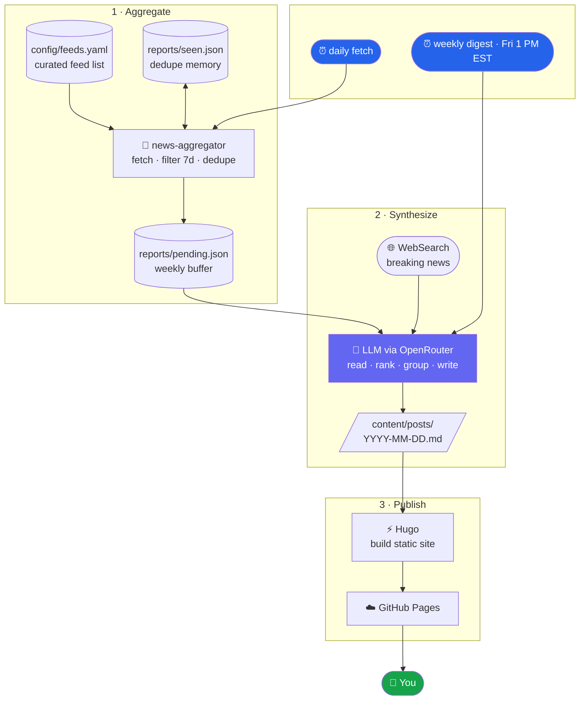

This site is fully automated. No one writes the digests by hand — a GitHub Actions
workflow collects feed entries every day, and every Friday another turns the week's
collection into a digest and publishes the site. Here's the full picture.

## Architecture

## Step by step

### 1 · Aggregate

A small Python tool (`news-aggregator`) reads the feed list from
[`config/feeds.yaml`](/sources/), fetches every feed, and keeps only entries from
the **last 7 days**. It runs **every day** — some feeds only keep a few hours of
history — and appends new entries to a buffer, `pending.json`. It tracks every URL
it has already seen in `seen.json`, so the same story is never collected twice.
On Friday the buffer holds the whole week's entries; the digest step consumes it
and starts a fresh one.

### 2 · Synthesize

An LLM, called through [OpenRouter](https://openrouter.ai), reads that raw JSON
and does the editorial work: it skips marketing fluff and minor patch notes, groups
articles that cover the same story, picks the week's top story, sorts everything
into themed categories, and assigns each item a relevance tier. It also runs a
**web search** to catch breaking news the RSS feeds may have missed. The output is
one Markdown post with front matter — the same format you're reading now.

### 3 · Publish

[Hugo](https://gohugo.io) builds the Markdown into this static site — archive,
navigation, RSS feed, and all — and the workflow deploys it to **GitHub Pages**.
Posts older than 90 days are pruned automatically to keep things current.

## The whole thing is open source

Feed config, aggregator, editorial prompt, and site templates all live in one
repo. Browse it, fork it, or suggest a feed on
[GitHub](https://github.com/dmorand17/news-aggregator).
